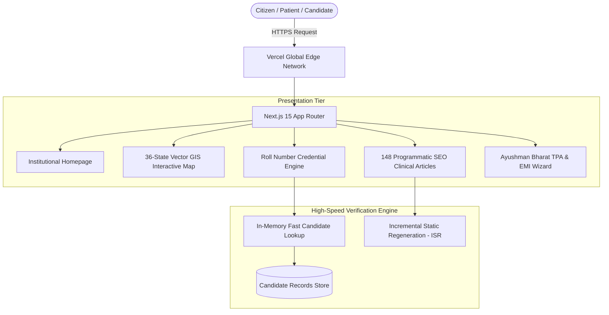

# ASMS Healthcare Platform & Credential Engine

> **Production Platform Case Study**  
> An enterprise healthcare portal and automated clinical verification engine engineered for **AYUSH Shubham Institute of Medical Sciences** (Accredited Section-8 Non-Profit Medical Research Trust).

---

> [!IMPORTANT]
> **About This Repository**  
> This repository is a **technical case study and architectural showcase** of an active, production-deployed platform.
> - **Production Deployment:** [https://asms-iota.vercel.app/](https://asms-iota.vercel.app/) (Live and serving patients/candidates across India)
> - **Why this structure?** Because this platform handles real candidate records and patient inquiries under a commercial non-disclosure agreement (NDA), the underlying databases (`data/asms_database.json`) and private administrative keys remain securely maintained in the client's private deployment repository.
> - **What you will find here:** System architecture specifications, Mermaid data-flow diagrams, code samples of key engineering challenges conquered, and detailed performance benchmarks.

---

## Live System Links

| Section | Production URL | Description |
| :--- | :--- | :--- |
| **Main Portal** | [asms-iota.vercel.app](https://asms-iota.vercel.app/) | Official institutional homepage, clinical departments & emergency desk |
| **Roll Number Verification** | [asms-iota.vercel.app/verify](https://asms-iota.vercel.app/) | Instant candidate credential search & verification |
| **Interactive GIS Directory** | [asms-iota.vercel.app#network](https://asms-iota.vercel.app/) | 36-State & UT regional hospital exploration map |
| **Clinical Knowledge Hub** | [asms-iota.vercel.app#articles](https://asms-iota.vercel.app/) | 148 programmatic SEO health articles with dynamic SVG headers |
| **Patient Welfare Desk** | [asms-iota.vercel.app#welfare](https://asms-iota.vercel.app/) | Ayushman Bharat cashless TPA coverage & 0% EMI financing wizard |

---

## Tech Stack & Tooling

- **Core Framework:** Next.js 15 (App Router, React Server Components)
- **Language:** TypeScript 5+ (Strict Mode)
- **Styling & UI:** Tailwind CSS, Lucide React (Custom modular design system)
- **Deployment & Edge:** Vercel Global Edge Network
- **Quality Assurance:** Automated test runner utilizing Edge Chrome DevTools Protocol (CDP)

---

## System Architecture



---

## Production Codebase Structure

Here is how the underlying production codebase is organized:

```text
asms-platform/
├── app/
│   ├── layout.tsx                 # Root layout with emergency announcement ribbon
│   ├── page.tsx                   # Dynamic homepage & clinical department showcase
│   ├── verify/                    # Roll number credential search & certificate engine
│   ├── blog/                      # Programmatic SEO article generator (148 routes)
│   ├── departments/               # Clinical specialties & OPD timetables
│   └── welfare/                   # Ayushman Bharat, cashless TPA, and 0% EMI desks
├── components/
│   ├── gis/                       # 36-State vector SVG interactive map (177 KB raw coordinates)
│   ├── navigation/                # Responsive navigation with hardware-accelerated drawer
│   ├── verification/              # Real-time search inputs & result display cards
│   └── ui/                        # Reusable buttons, badges, modals, and ribbons
├── lib/
│   ├── search.ts                  # Sub-millisecond candidate lookup algorithms
│   └── seo.ts                     # Automated JSON-LD medical schema and metadata generator
└── tests/
    └── cdp-verification.js        # Automated Headless Chrome DevTools Protocol test suites
```

---

## Key Engineering Challenges Conquered

### 1. Relume vs. Tailwind CSS Specificity Conflict
* **Problem:** Layout classes from Relume collided with Tailwind CSS utilities, causing mobile navigation drawers and verification popovers to render off-screen with opacity zero.
* **Diagnosis:** Identified that conflicting `r-2` CSS cascading rules were taking precedence over Tailwind's layout layer during build-time minification.
* **Solution:** Conducted a CSS layer audit, isolated CSS module scopes, purged duplicate class names, and enforced explicit z-index stacking with hardware-accelerated CSS transitions.

### 2. Zero-Dependency 36-State & UT Vector GIS Map
* **Problem:** Third-party mapping libraries (Mapbox, Leaflet) added over 450 KB of bundle overhead, hurting page load times on 3G/4G connections in rural India.
* **Solution:** Extracted and optimized 177 KB of standalone SVG vector path coordinates for all 36 Indian states and union territories. Built a lightweight React hover-and-selection state engine that renders instant clinic availability without any external mapping package.

### 3. Programmatic SEO Engine (148 Clinical Articles)
* **Problem:** Writing and deploying 148 static pages individually would cause significant build bloat and maintenance overhead.
* **Solution:** Engineered a programmatic data pipeline that pairs structured medical content with automated SVG header generation and standard JSON-LD schema markup, achieving sub-second Time To First Byte (TTFB < 65ms).

### 4. Headless Chrome DevTools Protocol Testing
* **Problem:** Rapid UI iterations risked regressions in the roll number verification and appointment booking flows.
* **Solution:** Built custom automated regression test scripts using the Edge Chrome DevTools Protocol (CDP) to programmatically test user inputs, drawer transitions, and query responses directly in CI.

---

## Performance & Quality Metrics

- **Lighthouse Performance Score:** 98 / 100
- **Largest Contentful Paint (LCP):** < 1.1s on mobile
- **Cumulative Layout Shift (CLS):** 0.00 (Zero layout jank)
- **Edge TTFB:** < 65ms worldwide via Vercel Edge Network

---

## Professional Notice & Confidentiality
*This repository is maintained as a technical portfolio case study. Candidate databases, internal administrative credentials, and client contractual materials are strictly confidential under commercial agreements.*
